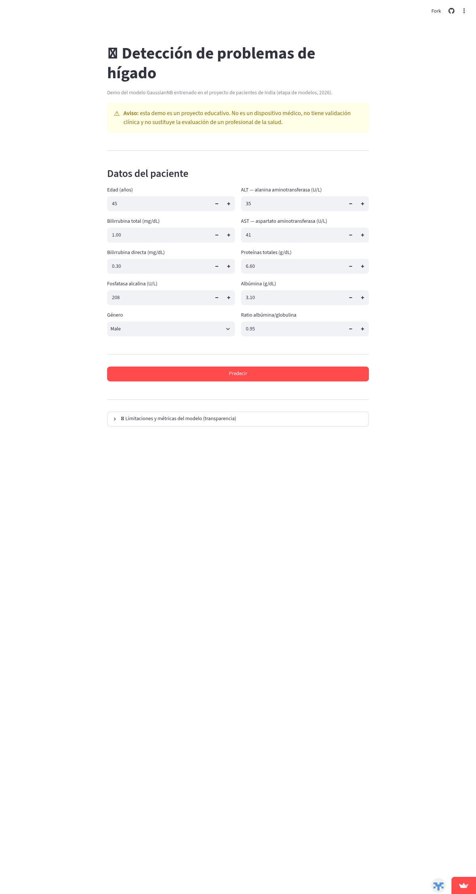

# Demo interactiva del modelo (Streamlit)

Esta demo permite probar en el navegador el modelo GaussianNB seleccionado como el
mejor del proyecto (f1_macro 0.741, roc_auc 0.861 en el conjunto de prueba): se
ingresan los valores de laboratorio de un paciente y la app devuelve la clasificación
con el umbral calibrado (0.0011), junto con las advertencias correspondientes.

## Cómo correr la demo localmente

Requisitos: Python 3.12 y un gestor de entornos (el proyecto usa `uv`, pero `pip`
también sirve).

**Opción A — desde la raíz del repositorio** (recomendada, deja el proyecto completo
a mano):

```bash
python -m venv .venv-demo
source .venv-demo/bin/activate      # en Windows: .venv-demo\Scripts\activate
pip install -r notebooks/7-deploy/requirements.txt
streamlit run notebooks/7-deploy/streamlit_app.py
```

**Opción B — parado dentro de `notebooks/7-deploy/`**:

```bash
cd notebooks/7-deploy
python -m venv .venv-demo
source .venv-demo/bin/activate      # en Windows: .venv-demo\Scripts\activate
pip install -r requirements.txt
streamlit run streamlit_app.py
```

En ambos casos la app localiza sola la raíz del proyecto (vía la ubicación de su
propio archivo) y carga el modelo desde
`models/pacientes_higado_clasificacion-gaussiannb-v2.joblib`, así que debe ejecutarse
desde un checkout completo del repositorio, no de la carpeta suelta.

## Demo desplegada

La demo está desplegada y funcionando en Streamlit Community Cloud:

**https://pacientes-higado-india.streamlit.app/**



## Cómo usar la demo

El formulario pide los 10 campos con los que fue entrenado el modelo. Todos los
valores por defecto cargan la **mediana del dataset de entrenamiento**, así que la
demo funciona tal cual sin tocar nada — basta pulsar **Predecir**.

| Campo del formulario | Descripción |
|---|---|
| Edad (años) | Edad del paciente |
| Género | Sexo del paciente (Male / Female) |
| Bilirrubina total (mg/dL) | Bilirrubina sérica total |
| Bilirrubina directa (mg/dL) | Fracción conjugada de la bilirrubina |
| Fosfatasa alcalina (U/L) | Enzima hepática (ALP) |
| ALT — alanina aminotransferasa (U/L) | Enzima hepática (SGPT) |
| AST — aspartato aminotransferasa (U/L) | Enzima hepática (SGOT) |
| Proteínas totales (g/dL) | Proteínas séricas totales |
| Albúmina (g/dL) | Fracción de albúmina |
| Ratio albúmina/globulina | Cociente albúmina/globulina |

Además, el formulario valida una restricción fisiológica: la **bilirrubina directa no
puede ser mayor que la bilirrubina total**; si eso ocurre, la app muestra un error y
no predice hasta corregir el valor.

### Cómo interpretar el resultado

- La clasificación mostrada **ya aplica el umbral calibrado (0.0011)** automáticamente:
  no hay que hacer ninguna cuenta, el botón **Predecir** compara el score crudo contra
  ese umbral (elegido en la etapa de selección para optimizar f1_macro) y devuelve la
  clase correspondiente.
- El **score que muestra la app NO es un porcentaje de riesgo calibrado**. El
  GaussianNB asume que las variables son independientes, pero en los datos varias
  están fuertemente correlacionadas (por ejemplo, la bilirrubina directa es parte de
  la total). Esa violación del supuesto infla la confianza numérica del modelo, como
  documenta el notebook de interpretación. Por eso el score debe leerse como un
  **ordenamiento** (más alto = más indicios de problema), no como una probabilidad
  clínica real.

### Limitaciones

- **Proyecto educativo**: la demo no es un dispositivo médico, no tiene validación
  clínica y no sustituye la evaluación de un profesional de la salud.
- **Dataset de entrenamiento pequeño**: 566 pacientes de un dataset público de India;
  valores de laboratorio muy fuera de los rangos típicos de ese dataset pueden dar
  resultados poco fiables.
- **Métricas reales en el conjunto de prueba** (114 pacientes no vistos en
  entrenamiento):

  | Métrica | Valor |
  |---|---|
  | f1_macro | 0.741 |
  | Recall clase "sin problemas" | 81.8 % |
  | Recall clase "problemas de hígado" | 74.1 % |

  Es decir: aproximadamente 1 de cada 4 pacientes enfermos no sería detectado y cerca
  de 1 de cada 5 pacientes sanos recibiría una alarma innecesaria.

## Cómo desplegar en Streamlit Community Cloud

La app actual se desplegó con estos pasos. El despliegue requiere iniciar sesión con
la cuenta de GitHub del dueño del repo, por lo que se hace manualmente; sirve también
para replicarlo en otro fork o cuenta:

1. Verificar que el repositorio es **público** en GitHub (requisito del plan gratuito
   de Streamlit Cloud).
2. Entrar a [share.streamlit.io](https://share.streamlit.io) e iniciar sesión con la
   cuenta de GitHub.
3. Pulsar **New app**.
4. En el formulario: seleccionar el repositorio (`Pacientes_porblemas_higado_india`),
   la rama (`main`) y como **main file path** indicar `notebooks/7-deploy/streamlit_app.py`
   — la app vive en esa subcarpeta, no en la raíz, así que hay que especificarlo.
5. Pulsar **Deploy** y esperar unos minutos a que instale
   `notebooks/7-deploy/requirements.txt`.
6. Una vez desplegada, la app queda disponible en la URL asignada y se re-despliega
   automáticamente con cada push a la rama configurada.

## Detalles técnicos relevantes

- **El umbral no viaja dentro del joblib**: el pipeline expone `predict_proba`, y la
  clasificación correcta es `(predict_proba(X)[:, 1] >= 0.0011)`. Usar `predict()`
  directo aplicaría el corte 0.5 por defecto y degradaría el f1_macro de 0.741 a
  0.631. La app aplica el umbral siempre.
- **Las versiones de las dependencias están fijadas** a las del entorno de
  entrenamiento (`requirements.txt` de esta carpeta) para que el joblib cargue sin
  incompatibilidades en la nube.
- **Roles de los archivos de dependencias**: `streamlit` está declarado en el
  `pyproject.toml` de la raíz, así que el flujo nativo del proyecto (`uv sync`) instala
  todo, incluida la demo. El `requirements.txt` y `runtime.txt` de esta carpeta existen
  **solo para Streamlit Community Cloud**, que instala la app desde un
  `requirements.txt` en la carpeta de la app y no sabe usar `uv.lock`; también sirven
  para quien prefiera `pip` (opciones A/B de más arriba). No son dos instalaciones
  contradictorias: son el mismo set de paquetes para dos mecanismos distintos.
- `runtime.txt` fija Python 3.12, la versión usada en el proyecto.
- El score que muestra la app no es una probabilidad calibrada: el notebook de
  interpretación documenta que la correlación entre las bilirrubinas infla la
  confianza numérica del GaussianNB.
